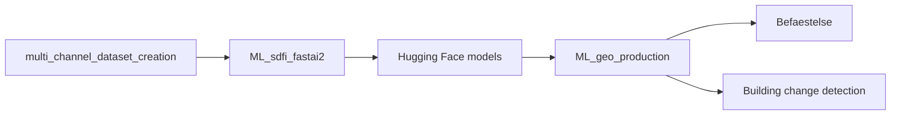

# Machine learning at KDS

Machine learning at the Danish Agency for Climate Data
([Klimadatastyrelsen](https://www.kds.dk), KDS): what we build, where it is
used, and where to find the open code, models, datasets and Docker images.

Technical details live in each repo's README. This page is the map.

## Projects

| Project | What it does | Use at KDS | Try it |
| --- | --- | --- | --- |
| **Befæstelse** (surface types) | Semantic segmentation of 10-channel aerial imagery into surface classes (asphalt, gravel, cobblestone, ...) | Fully funded, runs every year. Output on [Dataforsyningen](https://dataforsyningen.dk/labs/2259). Also used to map ground-mounted solar panels | [BEF example](https://github.com/Klimadatastyrelsen/ML_geo_production#befaestelse-bef) |
| **Ændringsudpegning** (Building change detection) | Ensemble that segments buildings and compares them with the existing map | Used by the municipalities in 2026 to find changes in the building map | [Change detection example](https://github.com/Klimadatastyrelsen/ML_geo_production#building-change-detection) |
| **Object detection** | YOLO detection in aerial and oblique images | Used in 2026 to detect windmills for change detection; output to be taken into use soon | [ML_object_detection](https://github.com/Klimadatastyrelsen/ML_object_detection) |
| **Point cloud classification** | Superpoint Transformer on `.laz` point clouds | Promising, not yet in production | [laz-superpoint_transformer](https://github.com/Klimadatastyrelsen/laz-superpoint_transformer) |

## Code

| Repo | Role |
| --- | --- |
| [multi_channel_dataset_creation](https://github.com/Klimadatastyrelsen/multi_channel_dataset_creation) | Labels, channel downloads and dataset creation; ships an example dataset |
| [ML_sdfi_fastai2](https://github.com/Klimadatastyrelsen/ML_sdfi_fastai2) | Training, inference and reports for semantic segmentation |
| [ML_geo_production](https://github.com/Klimadatastyrelsen/ML_geo_production) | Ensemble inference on GeoTIFFs and change detection against map polygons |
| [ML_object_detection](https://github.com/Klimadatastyrelsen/ML_object_detection) | Train YOLO detectors; sliced inference on large images |
| [danish-historical-map-yolo](https://github.com/rasmuspjohansson/danish-historical-map-yolo) | Object detection example on historical Danish maps |
| [laz-superpoint_transformer](https://github.com/Klimadatastyrelsen/laz-superpoint_transformer) | Point cloud segmentation with `.laz` support |




## Docker images

```bash
docker pull rasmuspjohansson/kds_cuda_pytorch:latest     # semantic segmentation repos + models
docker pull rasmuspjohansson/kds_spt_laz_pytorch:latest  # point clouds
```

[kds_cuda_pytorch](https://hub.docker.com/r/rasmuspjohansson/kds_cuda_pytorch) ·
[kds_spt_laz_pytorch](https://hub.docker.com/r/rasmuspjohansson/kds_spt_laz_pytorch)

## Hugging Face

| Models | Datasets |
| --- | --- |
| [KDS_Permeable_surfaces](https://huggingface.co/rasmuspjohansson/KDS_Permeable_surfaces) (Befæstelse) | [example_dataset](https://huggingface.co/datasets/rasmuspjohansson/example_dataset) (10-channel aerial example) |
| [KDS_buildings](https://huggingface.co/rasmuspjohansson/KDS_buildings) (change detection) | [KDS_building_change_detection](https://huggingface.co/datasets/rasmuspjohansson/KDS_building_change_detection) (training data for `KDS_buildings`) |
| [KDS_spt_laz](https://huggingface.co/rasmuspjohansson/KDS_spt_laz) (point clouds) | [KDS_objects_in_oblique_images](https://huggingface.co/datasets/rasmuspjohansson/KDS_objects_in_oblique_images) (YOLO) |
| | [KDS_laz_dataset](https://huggingface.co/datasets/rasmuspjohansson/KDS_laz_dataset) (`.laz` toy data) |

## Contact

Questions: [rajoh@kds.dk](mailto:rajoh@kds.dk). 

Licenses are given in each repo.
Some datasets on Hugging Face are private but can be made available by contacting KDS, provided they are intended for non-commercial use.
